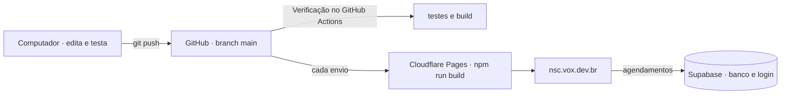

# Como colocar o site da NSC Garage no ar

Este guia leva o site do GitHub para o domínio da oficina, com o agendamento gravando num banco de
dados de verdade. São quatro peças, todas com plano gratuito:

| Peça          | Para quê                                                       | Serviço                    |
| ------------- | -------------------------------------------------------------- | -------------------------- |
| Código        | A fonte única do projeto; cada envio para `main` vai para o ar | GitHub                     |
| Banco e login | Guardar os agendamentos e deixar só a oficina entrar           | Supabase                   |
| Hospedagem    | Gerar o site a partir do GitHub e servir com HTTPS             | Cloudflare Pages           |
| Domínio       | O endereço `nsc.vox.dev.br` apontando para a hospedagem        | Registro.br (`vox.dev.br`) |



Tempo estimado: uma hora, mais a espera do DNS (de minutos a algumas horas).

> **Sem o banco o site também funciona**, em modo de demonstração: os agendamentos ficam só no
> navegador de quem usa e a oficina não os vê. Serve para a apresentação, não para atender clientes.
> O site escolhe o modo sozinho: com as duas variáveis do passo 2 no build, usa o Supabase.

---

## Antes de começar

- [ ] Número do WhatsApp da oficina em `contact.whatsapp` (`src/content/site.ts`), no formato
      `55` + DDD + número, só dígitos (exemplo: `5513987654321`). Hoje está o número de testes
      `5513981197295`.
- [ ] Horário de atendimento em `contact.hours` (`src/content/site.ts`) e as mesmas horas na agenda
      (`src/content/scheduling.ts`). Se mudar a agenda, mude também a função `horario_valido` na
      migração do banco: as duas precisam dizer a mesma coisa.
- [ ] Texto do aviso de privacidade revisado pela oficina (`src/pages/PrivacyPage.tsx`): prazo de
      guarda dos dados e quem atende os pedidos.
- [ ] Autorização para as fotos da Trajetória (são de terceiros, com crédito) ou troca pelo acervo
      da NSC em `src/assets/images/history/`.
- [ ] Conferir os marcos 14 (Endurance, uma fonte só) e 15 (Recife: o texto fala de um evento futuro
      e precisa mudar de tempo depois que ele acontecer) em `src/content/milestones.ts`.
- [ ] Node.js 22 (a versão fica em `.node-version`) e o Git no computador, com o repositório
      clonado do GitHub (`git clone https://github.com/fabiobombardelli/nsc-garage-site.git`).

---

## 1. Banco de dados (Supabase)

1. Crie uma conta em [supabase.com](https://supabase.com) e um projeto novo (**New project**):
   - nome: `nsc-garage`;
   - região: **South America (São Paulo)**, para o site responder rápido;
   - senha do banco: gere uma forte e guarde num gerenciador de senhas. O site não usa essa senha.
2. Abra **SQL Editor → New query**, cole todo o conteúdo de
   `supabase/migrations/20261105000000_agenda.sql` e clique em **Run**. Deve aparecer "Success". A
   migração cria as tabelas, trava o acesso direto a elas e cria as funções que o site chama. Pode
   rodar de novo sem estragar nada.
3. Desligue o cadastro aberto: **Authentication → Sign In / Providers** e desmarque **Allow new
   users to sign up**. Só quem você criar consegue entrar.
4. Crie o login da oficina: **Authentication → Users → Add user → Create new user**, com o e-mail
   da oficina, uma senha forte e **Auto Confirm User** marcado.
5. Diga ao banco que esse login é da equipe. No **SQL Editor**, rode (troque o e-mail):

   ```sql
   insert into public.oficina_admins (user_id)
   select id from auth.users where email = 'contato@nscgarage.com.br';
   ```

   Repita os passos 4 e 5 para cada pessoa da equipe. Para tirar alguém:
   `delete from public.oficina_admins where user_id = (select id from auth.users where email = '…');`

6. Copie os dois dados de conexão (botão **Connect** no topo do projeto, ou **Project Settings →
   API Keys**):
   - **Project URL**, como `https://abcdefgh.supabase.co`;
   - a chave pública: **anon** (ou **publishable**, que começa com `sb_publishable_`).

   **Nunca** use a chave `service_role` (ou `secret`) no site: ela ignora todas as travas do banco.

### O que protege os dados

- As tabelas têm RLS ligado e nenhuma permissão direta: nem visitante nem login lê ou altera uma
  linha sozinho.
- Tudo passa por funções do banco que conferem as regras de novo (horário válido, 24 h para
  cancelar, uma avaliação por atendimento, transições permitidas). O navegador valida antes só para
  avisar mais rápido.
- Quem visita só vê **quais horários estão ocupados**, sem nome nem telefone.
- Consultar, cancelar e avaliar exigem protocolo **e** o telefone usado no agendamento.
- A agenda completa e a mudança de situação só respondem para quem está em `oficina_admins`.
- Dois pedidos para o mesmo horário: o banco tem um índice único por dia e hora dos agendamentos
  ativos, e o segundo é recusado (RNF-06).

Os testes em `supabase/` rodam esse mesmo SQL num PostgreSQL de verdade (PGlite) a cada `npm test`.

---

## 2. Testar no seu computador com o banco ligado

No ar, quem gera o site é a Cloudflare (passo 3). Este passo é para conferir antes, no seu
computador. Na pasta do projeto:

```bash
cp .env.example .env
```

Abra o `.env` e cole a URL e a chave do passo 1.6. Depois:

```bash
npm ci
```

```bash
npm run build
```

O site final fica em `dist/`. Para conferir antes de publicar:

```bash
npm run preview
```

Abra o endereço que aparecer, faça um agendamento de teste e entre em `#/painel` com o e-mail e a
senha do passo 1.4. O agendamento tem que aparecer na agenda. Se aparecer "Não foi possível falar
com a agenda", confira a URL e a chave no `.env` e gere o build de novo (as variáveis entram no
momento do build).

> O `.env` está no `.gitignore` e não vai para o repositório. A chave anon vai dentro do site
> publicado de qualquer jeito (é pública por natureza); o que não pode vazar é a `service_role`.

---

## 3. Hospedagem ligada ao GitHub (Cloudflare Pages)

O código fica no GitHub (`fabiobombardelli/nsc-garage-site`, privado). A Cloudflare lê o
repositório, gera o site e publica sozinha a cada envio para a branch `main`.

1. Crie uma conta gratuita em [cloudflare.com](https://dash.cloudflare.com).
2. **Workers & Pages → Create → Pages → Connect to Git** (ou "Import an existing Git repository").
   Se a tela abrir em Workers, procure o link para Pages. Autorize o aplicativo da Cloudflare no
   GitHub **só para o repositório `nsc-garage-site`**.
3. Configure o build:

   | Campo                  | Valor           |
   | ---------------------- | --------------- |
   | Project name           | `nsc-garage`    |
   | Production branch      | `main`          |
   | Framework preset       | None            |
   | Build command          | `npm run build` |
   | Build output directory | `dist`          |

4. Em **Environment variables**, crie `VITE_SUPABASE_URL` e `VITE_SUPABASE_ANON_KEY` com os
   valores do passo 1.6. Depois, em **Settings → Variables and Secrets**, confira que as duas estão
   **só em Production**: assim as prévias de outras branches rodam em modo de demonstração e não
   mexem na agenda real.
5. **Save and Deploy**. Em poucos minutos o site abre em `https://nsc-garage.pages.dev` (se o nome
   estiver ocupado, a Cloudflare acrescenta um sufixo: use o endereço que ela mostrar). Teste tudo
   lá antes do domínio.

A Cloudflare lê a versão do Node em `.node-version` e instala com `npm ci`. O arquivo
`public/_headers` liga cabeçalhos de segurança e o cache longo dos arquivos com hash. Como a
navegação usa `#/`, não é preciso nenhuma regra de redirecionamento.

No GitHub, o fluxo **Verificação** (`.github/workflows/ci.yml`) roda formatação, tipos, lint, os
testes e o build a cada envio e a cada pull request: se ficar vermelho, algo quebrou.

**Sem GitHub (envio manual):** **Workers & Pages → Create → Pages → Upload assets** e arraste a
pasta `dist/` gerada no passo 2. Ou, pelo terminal, `npx wrangler pages deploy dist --project-name
nsc-garage`. Só que aí cada atualização também é manual.

---

## 4. Apontar o domínio

### Num subdomínio, mantendo o DNS no Registro.br (o caso da NSC: `nsc.vox.dev.br`)

Só um registro novo; o resto do domínio (site principal, e-mail) não muda.

1. **Primeiro na Cloudflare:** no projeto do Pages, **Custom domains → Set up a custom domain**,
   digite `nsc.vox.dev.br` e siga até ela mostrar o registro CNAME a criar. Nessa ordem: um CNAME
   criado antes de cadastrar o domínio no Pages dá erro 522.
2. **Depois no Registro.br:** [registro.br](https://registro.br) → **Painel** → `vox.dev.br` →
   **DNS** → **Editar zona** (ou "Configurar zona DNS") → **Nova entrada**:

   | Tipo  | Nome  | Dados                  |
   | ----- | ----- | ---------------------- |
   | CNAME | `nsc` | `nsc-garage.pages.dev` |

   Salve. Se o painel disser que o domínio usa outros servidores DNS (de uma hospedagem, por
   exemplo), crie o mesmo CNAME lá, e não no Registro.br.

3. Volte ao Pages e espere o domínio ficar **Active**. O HTTPS é emitido sozinho, em minutos (às
   vezes leva algumas horas, enquanto o DNS se espalha).
4. No Supabase, **Authentication → URL Configuration → Site URL**: `https://nsc.vox.dev.br`.

### No domínio inteiro (raiz), passando o DNS para a Cloudflare

A Cloudflare Pages só aceita a raiz do domínio (`seudominio.com.br`) quando ela cuida do DNS:

1. No painel da Cloudflare, **Add a domain** (plano Free) e digite o seu domínio. Ela importa os
   registros que já existem.
2. **Atenção ao e-mail:** se o domínio já tem e-mail (Google Workspace, Hostinger, Zoho…), confira
   se os registros `MX` e `TXT` foram importados. Sem eles o e-mail para de chegar.
3. A Cloudflare mostra dois servidores de nome, como `ana.ns.cloudflare.com`. No Registro.br:
   **Painel → o domínio → DNS → Alterar servidores DNS**, cole os dois e salve. Em outros
   registradores o nome é parecido ("Nameservers" ou "Servidores DNS").
4. Quando a Cloudflare disser que o domínio está ativo, volte ao projeto do Pages: **Custom domains →
   Set up a custom domain**, adicione `seudominio.com.br` e depois `www.seudominio.com.br`.
5. O HTTPS é emitido sozinho, em alguns minutos.

### Com Netlify, mantendo o DNS onde está

No Netlify: **Domain management → Add a domain**. No painel do registrador, crie:

| Tipo  | Nome  | Valor                  |
| ----- | ----- | ---------------------- |
| A     | `@`   | `75.2.60.5`            |
| CNAME | `www` | `seu-site.netlify.app` |

---

## 5. Depois de publicar

- [ ] No domínio, faça o ciclo completo: agendar, ver no painel, confirmar, "Avisar cliente pelo
      WhatsApp", consultar em "Meus agendamentos", cancelar outro e avaliar um concluído.
- [ ] Abra no celular e teste o painel de acessibilidade (texto 150%, alto contraste, reduzir
      movimento).
- [ ] Apague os agendamentos de teste. No SQL Editor:
      `delete from public.agendamentos where cliente_telefone = 'SEU_TELEFONE_DE_TESTE';`
      (o histórico vai junto).
- [ ] No Supabase, **Authentication → URL Configuration**, ponha o domínio em **Site URL**.

### Cuidados no plano gratuito

- **Projeto pausado:** o Supabase pausa projetos gratuitos que ficam cerca de uma semana sem uso.
  O site mostra "Não foi possível falar com a agenda"; basta abrir o projeto no painel e clicar em
  **Restore**. Para uma oficina com clientes de verdade, o plano pago evita isso.
- **Cópia dos dados:** o plano gratuito não guarda backups para baixar. De vez em quando, exporte a
  tabela `agendamentos` em **Table Editor → Export to CSV**.
- **Pedidos falsos:** qualquer pessoa pode agendar sem login (é o que a oficina quer). Se aparecer
  abuso, os próximos passos são um desafio anti-robô (Cloudflare Turnstile) e um limite de pedidos
  por telefone no banco.

---

## 6. Atualizar o site depois

O GitHub é a fonte única: o que está na `main` é o que está no ar.

- **Mudança pequena (texto, foto):** edite, rode a verificação rápida e envie:

  ```bash
  git add -A
  ```

  ```bash
  git commit -m "Troca a foto do box"
  ```

  ```bash
  git push
  ```

  Em poucos minutos a Cloudflare publica. Em **Deployments** ficam todas as versões, e dá para
  voltar a uma anterior com um clique (**Rollback**).

- **Mudança maior:** trabalhe numa branch (`git switch -c nova-secao`), envie e abra um pull request.
  A Cloudflare gera um endereço de prévia só daquela branch, em modo de demonstração; o fluxo
  Verificação roda os testes. Quando estiver bom, junte na `main` e vai para o ar.
- **Regra da agenda:** mude no domínio (`src/features/scheduling/domain/` e
  `src/content/scheduling.ts`) **e** numa migração nova em `supabase/migrations/`, rodada no SQL
  Editor. Rode `npm test`: os testes do banco mostram se os dois lados ainda concordam.

## Problemas comuns

| Sintoma                                 | Causa provável e solução                                                                    |
| --------------------------------------- | ------------------------------------------------------------------------------------------- |
| "Não foi possível falar com a agenda"   | URL ou chave erradas no build, ou projeto pausado no Supabase                               |
| O site diz "versão de demonstração"     | O build foi gerado sem o `.env`. Gere de novo com as duas variáveis                         |
| "Este usuário não tem acesso ao painel" | O usuário não está em `oficina_admins` (passo 1.5)                                          |
| Horários de hoje somem antes da hora    | O banco usa o horário de Brasília (`America/Sao_Paulo`) e 2 h de antecedência (RN-03)       |
| Domínio não abre depois de horas        | Confira os servidores DNS no registrador e se o domínio está "Active" na Cloudflare         |
| Erro 522 no subdomínio                  | O CNAME foi criado antes de cadastrar o domínio no Pages: cadastre lá e espere validar      |
| O HTTPS do domínio nunca fica pronto    | Algum registro `CAA` no domínio proíbe a autoridade da Cloudflare: inclua-a ou apague o CAA |
