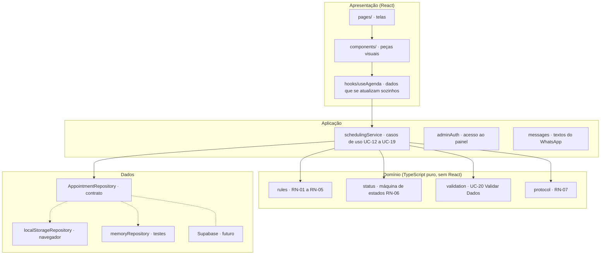
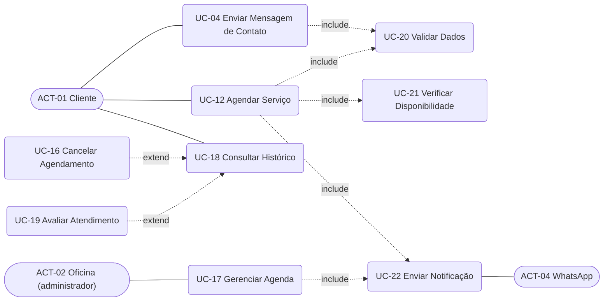
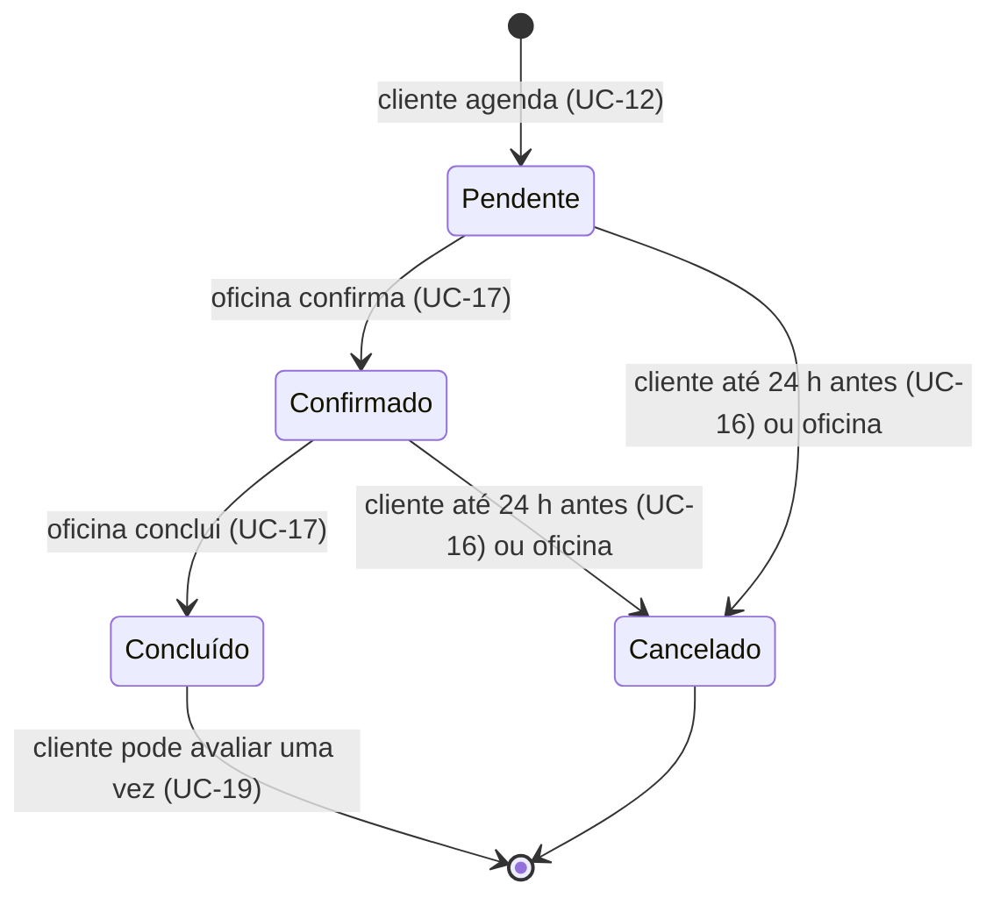
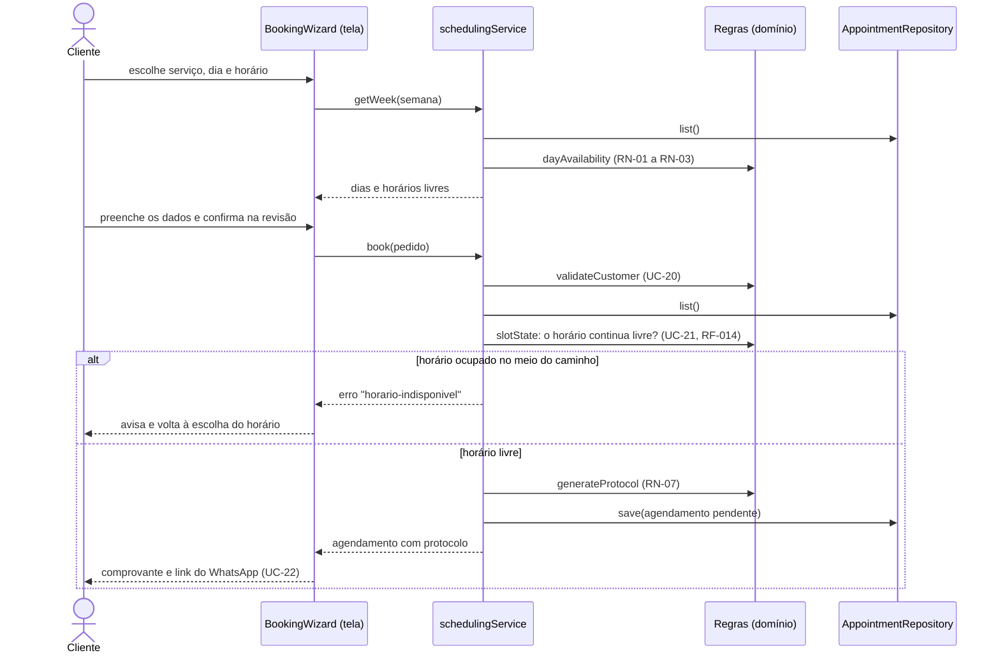
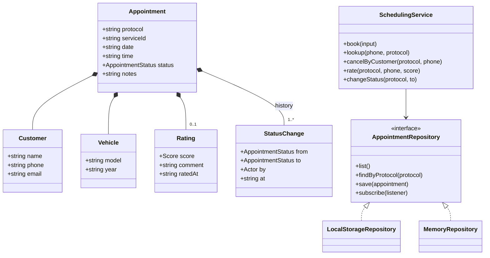

# NSC Garage: site e sistema de agendamento

Site institucional e sistema de agendamento da **NSC Garage**, oficina premium que prepara carros
de drift e competição e faz manutenção de esportivos e importados.

> Projeto de extensão curricularizado das disciplinas de **Acessibilidade** e **Engenharia de
> Software**, Fatec Rubens Lara, 2026, desenvolvido para um cliente real da comunidade.

**Meta de qualidade:** WCAG 2.2 nível AA, eMAG 3.1 e Lei Brasileira de Inclusão (art. 63).
**Stack:** React 19, TypeScript, Vite, Tailwind CSS 4, Motion e Vitest.

## Sumário

1. [Sobre o projeto](#1-sobre-o-projeto)
2. [Equipe](#2-equipe)
3. [O que o sistema faz](#3-o-que-o-sistema-faz)
4. [Roteiro para a apresentação](#4-roteiro-para-a-apresentação)
5. [Tecnologias e linguagens](#5-tecnologias-e-linguagens)
6. [Arquitetura](#6-arquitetura)
7. [Engenharia de Software](#7-engenharia-de-software)
8. [Acessibilidade](#8-acessibilidade)
9. [Design e movimento](#9-design-e-movimento)
10. [Como rodar](#10-como-rodar)
11. [Guia de manutenção](#11-guia-de-manutenção)
12. [Estrutura de pastas](#12-estrutura-de-pastas)
13. [Limitações e próximos passos](#13-limitações-e-próximos-passos)
14. [Referências](#14-referências)

---

## 1. Sobre o projeto

### O cliente

A NSC Garage é uma oficina fundada e liderada por Neto, com mais de uma década de resultados,
títulos internacionais e um papel pioneiro na estruturação do drift no Brasil. Atende dois
públicos com o mesmo peso:

- **pilotos e equipes de drift e automobilismo**, que procuram quem monte e acerte carros de
  competição;
- **donos de esportivos e importados**, que procuram manutenção premium e confiam numa oficina que
  também prepara carros de pista.

Os dois chegam principalmente pelo Instagram, pelo WhatsApp e por indicação, quase sempre pelo
celular.

### O problema

A oficina não tinha um site próprio que mostrasse quem ela é, e marcar uma avaliação dependia de
troca de mensagens: perguntar horários, esperar resposta, confirmar à mão. Não havia como o cliente
ver se o horário estava livre, acompanhar o pedido ou avaliar o atendimento, nem como a oficina
organizar a agenda num lugar só.

### O objetivo

1. Um site que apresente a oficina com o peso que ela tem na pista.
2. Um **sistema de agendamento** em que o cliente escolha serviço, dia e horário livres, receba um
   protocolo, acompanhe, cancele e avalie, e em que a oficina confirme e conclua os atendimentos.
3. Tudo **acessível**: usável por quem navega só pelo teclado, usa leitor de tela, enxerga pouco, é
   daltônico ou sente desconforto com movimento.

### Por que é um projeto de extensão

O trabalho atende uma demanda real de um negócio da comunidade, com requisitos levantados junto ao
cliente, e aplica as duas disciplinas ao mesmo produto:

- **Engenharia de Software:** requisitos com ID único, casos de uso, regras de negócio, máquina de
  estados, matriz de rastreabilidade, arquitetura em camadas e testes automatizados ligados aos
  casos de teste.
- **Acessibilidade:** WCAG 2.2 AA em todas as telas, atalhos do eMAG, painel de acessibilidade,
  declaração de acessibilidade e testes automáticos de acessibilidade a cada entrega.

---

## 2. Equipe

<!-- Preencha os nomes completos e os links. Acrescente ou remova linhas conforme o grupo. -->

| Integrante                      | Papel no projeto | GitHub | LinkedIn |
| ------------------------------- | ---------------- | ------ | -------- |
| [Nome completo do integrante 1] | [papel]          | [link] | [link]   |
| [Nome completo do integrante 2] | [papel]          | [link] | [link]   |
| [Nome completo do integrante 3] | [papel]          | [link] | [link]   |
| [Nome completo do integrante 4] | [papel]          | [link] | [link]   |

**Orientação:** [Professor(a) de Acessibilidade] · [Professor(a) de Engenharia de Software]
**Curso:** [nome do curso] · Fatec Rubens Lara · [semestre]/2026
**Cliente:** NSC Garage

---

## 3. O que o sistema faz

| Tela                         | Endereço              | Para quem | O que faz                                                                                           |
| ---------------------------- | --------------------- | --------- | --------------------------------------------------------------------------------------------------- |
| Página inicial               | `#inicio`             | Visitante | Vídeo da equipe, trajetória com o carro derrapando na pista, a oficina, os serviços e o contato.    |
| Agendar avaliação            | `#/agendar`           | Cliente   | Quatro etapas: serviço, dia e horário livres, dados do cliente e do carro, revisão. Gera protocolo. |
| Meus agendamentos            | `#/meus-agendamentos` | Cliente   | Com telefone + protocolo, mostra a situação, permite cancelar (até 24 h antes) e avaliar.           |
| Painel da oficina            | `#/painel`            | Oficina   | Acesso por senha. Agenda por dia, filtro por situação, confirmar, concluir, cancelar, avisar.       |
| Declaração de acessibilidade | `#/acessibilidade`    | Todos     | Compromisso, ajustes, atalhos, o que foi verificado, limitações e canal para relatar barreiras.     |

Em todas as telas: **painel de acessibilidade** (tamanho do texto, alto contraste, reduzir
movimento), atalhos de teclado e o contato pelo WhatsApp no rodapé.

### Regras de negócio (RN)

Os valores ficam em `src/content/scheduling.ts` e são provisórios até a oficina confirmar.

| ID    | Regra                                                                            | Valor atual                         |
| ----- | -------------------------------------------------------------------------------- | ----------------------------------- |
| RN-01 | A agenda é o horário de funcionamento dividido em horários de duração fixa       | Seg–sex 8h–18h, sáb 8h–12h, 60 min  |
| RN-02 | Capacidade por horário                                                           | 1 carro                             |
| RN-03 | Não se agenda no passado nem em cima da hora; a agenda abre até N dias à frente  | 2 h de antecedência, 30 dias        |
| RN-04 | O cliente cancela pelo site até X horas antes; depois, só a oficina              | 24 h                                |
| RN-05 | Só agendamento concluído pode ser avaliado, uma única vez, nota inteira de 1 a 5 | —                                   |
| RN-06 | Só as transições do ciclo de vida são permitidas                                 | ver diagrama de estados             |
| RN-07 | Todo agendamento recebe um protocolo único exibido no comprovante                | `NSC-` + 6 caracteres sem 0/O/1/I/L |

---

## 4. Roteiro para a apresentação

Uma demonstração de cerca de 10 minutos, que passa pelas duas disciplinas.

1. **Página inicial.** Role a página: o vídeo fica preso enquanto o slogan sai pelas laterais, e o
   350Z desce a pista da Trajetória acendendo os cones.
2. **Acessibilidade na prática.** Aperte Tab: aparecem os atalhos do eMAG. Abra o botão
   **Acessibilidade** no topo e mostre texto em 150%, alto contraste e reduzir movimento. Tudo vale
   na hora e o layout não quebra.
3. **Agendar.** Em Serviços, abra a gaveta "Preparação para drift" e clique em "Agendar avaliação".
   A cada etapa o carro dirige até o próximo cone. Tente avançar com campos vazios para mostrar os
   erros (texto, ícone e foco no primeiro campo). Confirme na revisão: o carro fica fazendo "zerinhos"
   em volta do cone (com botão de pausa) e o protocolo aparece.
4. **Tempo real.** Abra o agendamento em duas abas e escolha o mesmo horário: quando uma aba
   confirma, a outra desmarca o horário e avisa (RF-014 e RNF-06).
5. **Painel da oficina.** Entre em `#/painel` (senha de demonstração: `oficina2026`), carregue os
   exemplos, confirme e conclua o seu agendamento e use "Avisar cliente pelo WhatsApp".
6. **Cliente avalia.** Em "Meus agendamentos", consulte com telefone e protocolo e avalie o
   atendimento concluído (RN-05: só uma vez).
7. **Engenharia por trás.** Rode `npm test` (54 testes com os IDs dos casos de teste) e mostre os
   diagramas e a matriz de rastreabilidade deste documento.
8. **Só teclado.** Faça um agendamento sem mouse: Tab, setas nas opções, Espaço e Enter.

---

## 5. Tecnologias e linguagens

### Linguagens

| Linguagem                | Onde                                                                 |
| ------------------------ | -------------------------------------------------------------------- |
| **TypeScript / TSX**     | Todo o código da aplicação (`src/`), com tipagem estrita             |
| **CSS**                  | Estilos em camadas, um arquivo por seção (`src/styles/`)             |
| **HTML**                 | Página base (`index.html`) e a semântica gerada pelos componentes    |
| **JavaScript (Node.js)** | Testes de navegador e acessibilidade (`scripts/qa/*.cjs`)            |
| **Python**               | Script que monta a página de prévia (`scripts/artifact-page.py`)     |
| **Markdown e Mermaid**   | Documentação e diagramas (este README, `ACESSIBILIDADE.md`, `docs/`) |

### Ferramentas e bibliotecas

| Tecnologia                | Para que serve                            | Por que escolhemos                                                           |
| ------------------------- | ----------------------------------------- | ---------------------------------------------------------------------------- |
| **React 19**              | Interface em componentes                  | Componentes reutilizáveis, padrão de mercado, ótimo suporte a acessibilidade |
| **TypeScript 6**          | Tipos em todo o código                    | Erros pegos antes de rodar; o modelo de domínio vira tipos legíveis          |
| **Vite 8**                | Servidor de desenvolvimento e build       | Rápido, gera site 100% estático com caminhos relativos                       |
| **Tailwind CSS 4**        | Tokens de design (`@theme`) e utilitários | Cores e tamanhos num lugar só; o alto contraste troca só os tokens           |
| **Motion 14**             | Animações (entradas, header, carro)       | Respeita o movimento reduzido de forma centralizada (`MotionConfig`)         |
| **Archivo Variable**      | Fonte única, com eixo de largura          | Servida pelo próprio site (sem depender do Google), comprimida para títulos  |
| **lucide-react**          | Ícones em traço                           | Conjunto consistente, ícones decorativos com `aria-hidden`                   |
| **Vitest 5**              | Testes unitários e de casos de uso        | Integrado ao Vite, roda no Node em menos de 1 segundo                        |
| **Playwright + axe-core** | Testes no navegador e de acessibilidade   | Automatiza teclado, foco, contraste e o WCAG em todas as telas e modos       |
| **ESLint + Prettier**     | Qualidade e formatação                    | Código uniforme, revisões mais fáceis                                        |
| **Git**                   | Versionamento                             | Histórico de cada entrega, commits descritivos em português                  |
| **Claude Code**           | Assistente de programação com IA          | Apoio na implementação e nos testes, com revisão e decisões da equipe        |

---

## 6. Arquitetura

O site é uma **aplicação de página única** (SPA) estática. Não há servidor: o build em `dist/`
pode ser publicado em qualquer hospedagem. O agendamento foi escrito em **camadas**, para que as
regras de negócio não dependam da tela nem do armazenamento.



### Padrões usados

- **Camada de domínio pura:** `src/features/scheduling/domain/` não importa React nem o navegador.
  O "agora" chega por parâmetro, então os testes simulam qualquer data e hora.
- **Repository:** as regras falam com um contrato (`AppointmentRepository`), não com o
  `localStorage`. Trocar pelo Supabase é escrever outra implementação e mudar **uma linha** em
  `src/features/scheduling/index.ts`. Os métodos já devolvem `Promise`, como uma API remota.
- **Casos de uso como serviço:** cada método de `schedulingService` é um caso de uso da
  especificação (`book` = UC-12, `cancelByCustomer` = UC-16, `changeStatus` = UC-17…).
- **Injeção de dependência:** o serviço recebe o repositório, o relógio e o gerador aleatório. Nos
  testes, entram um repositório em memória e um relógio fixo.
- **Máquina de estados:** as transições permitidas ficam numa tabela (`TRANSITIONS`); a tela só
  mostra os botões que a tabela permite.
- **Tempo real entre abas:** o repositório avisa mudanças pelo evento `storage` do navegador; o
  hook `useAgenda` recarrega sozinho.
- **Navegação por hash** (`#/agendar`), sem biblioteca: funciona em qualquer hospedagem estática,
  até em subpasta, e cuida do foco e do título a cada troca de tela.

---

## 7. Engenharia de Software

### 7.1 Como o projeto foi construído

| Fase                   | O que foi feito                                                                                                    |
| ---------------------- | ------------------------------------------------------------------------------------------------------------------ |
| Levantamento           | Conversas com o cliente, 21 requisitos funcionais com ID, matriz RF → UC → TC                                      |
| Revisão de requisitos  | Revisão crítica (23/10/2026): granularidade dos casos de uso, atores, RNF, regras de negócio, ciclo de vida        |
| Protótipo              | Primeira versão do site num gerador visual, depois migrada para um projeto React + Vite limpo                      |
| Direção visual         | Três rodadas com o cliente até "o box à noite"; o fundo claro foi rejeitado                                        |
| Site institucional     | Topo com vídeo, Trajetória com a pista, Oficina, Serviços, Contato e rodapé                                        |
| Base de acessibilidade | Tokens de alto contraste, movimento reduzido, fonte ampliada, atalhos do eMAG, testes automáticos                  |
| Sistema de agendamento | Domínio, testes, repositório, casos de uso, telas, painel da oficina                                               |
| Padronização WCAG      | Painel de acessibilidade, declaração, borda de controles, foco em todas as telas, testes em todas as telas e modos |

O histórico do Git registra cada passo (`git log`). As decisões da revisão de requisitos adotadas
nesta versão:

1. Casos de uso consolidados: UC-12 **Agendar Serviço** (antes UC-12 a UC-15) e UC-04 **Enviar
   Mensagem de Contato** (antes UC-03 e UC-04).
2. RF-010 e RF-011 reclassificados como **não funcionais** (RNF-01), mantendo os IDs.
3. Identificação do cliente por **telefone + protocolo**, sem criar conta.
4. Contato e notificações pelo **WhatsApp**.
5. Lista de serviços **fixa** nesta versão (sem RF-025).
6. Valores de RN-01 a RN-04 provisórios, a confirmar com a oficina.
7. RF-022 (autenticar administrador) e RNF-05 (LGPD) adotados.

### 7.2 Requisitos

A matriz completa, com o arquivo e o teste de cada requisito, está em
[`docs/rastreabilidade.md`](docs/rastreabilidade.md). Resumo:

| Grupo                                   | Requisitos      | Situação                                                                            |
| --------------------------------------- | --------------- | ----------------------------------------------------------------------------------- |
| Apresentação, serviços e contato        | RF-001 a RF-009 | Implementados; conteúdo e contatos ainda provisórios                                |
| Acessibilidade (agora RNF-01)           | RF-010, RF-011  | Implementados e verificados por testes automáticos; teste manual pendente           |
| Agendamento                             | RF-012 a RF-016 | Implementados                                                                       |
| Notificação                             | RF-017, RF-024  | Parcial: o site monta a mensagem e abre o WhatsApp; envio automático exige servidor |
| Cancelar, gerenciar, histórico, avaliar | RF-018 a RF-021 | Implementados                                                                       |
| Acesso da oficina                       | RF-022          | Protótipo (senha conferida no navegador)                                            |
| Identificação para consulta             | RF-023          | Implementado (telefone + protocolo)                                                 |

### 7.3 Casos de uso



- **UC-16** e **UC-19** estendem UC-18: só acontecem a partir de um agendamento selecionado na
  consulta (cancelar: pendente ou confirmado e dentro do prazo; avaliar: concluído e ainda não
  avaliado).
- **UC-17** tem um subfluxo por ação: listar, confirmar, concluir e cancelar.
- Acessibilidade não aparece como caso de uso: é requisito não funcional de todas as telas.

### 7.4 Ciclo de vida do agendamento (RN-06)



Concluído e Cancelado são estados finais. Cancelar libera o horário para outra pessoa.

### 7.5 Sequência do caso de uso "Agendar Serviço"



### 7.6 Modelo de domínio



### 7.7 Testes

| Nível                      | Ferramenta            | Onde                                         | O que cobre                                                                                                   |
| -------------------------- | --------------------- | -------------------------------------------- | ------------------------------------------------------------------------------------------------------------- |
| Unidade (regras)           | Vitest                | `src/features/scheduling/domain/`            | TC-014 disponibilidade, TC-015 dados, TC-016 protocolo, TC-018 cancelamento, TC-019 estados, TC-021 avaliação |
| Casos de uso               | Vitest                | `.../services/*.test.ts`                     | UC-12, UC-16, UC-17, UC-18, UC-19 com repositório em memória e relógio fixo                                   |
| Acessibilidade             | Playwright + axe-core | `scripts/qa/axe.cjs`, `telas.cjs`            | WCAG 2.2 AA em todas as telas e estados, em 4 modos e 2 larguras                                              |
| Ponta a ponta pelo teclado | Playwright            | `scripts/qa/keyboard.cjs`, `agendamento.cjs` | Fluxos completos só com teclado, foco, erros e troca de tela                                                  |
| Layout                     | Playwright            | `scripts/qa/layout.cjs`                      | Espaçamento de texto, fonte 150%, sem cortes de 320 a 1920 px, foco não coberto                               |

Técnicas aplicadas, como pede o plano de testes: **partição de equivalência** (telefones e
e-mails válidos e inválidos), **valor-limite** (cancelar exatamente 24 h antes, 1 minuto antes e 1
minuto depois; antecedência de 2 h; ano 1949/1950), **tabela de decisão** (horário livre, ocupado,
passado, fora da janela), **transição de estados** (toda transição válida passa e toda inválida é
recusada) e **concorrência** (dois pedidos para o mesmo horário: o segundo é recusado ao gravar).

Resultado desta entrega: 54 de 54 testes unitários, 0 violações do axe em 112 verificações, 39 de
39 verificações de teclado.

### 7.8 Qualidade de código

- TypeScript estrito (`strict`, `noUncheckedIndexedAccess`), ESLint e Prettier sem avisos.
- Nenhuma regra de negócio dentro de componente React: componentes chamam o serviço.
- Textos e dados editáveis em `src/content/`; cores e tamanhos só em tokens (`theme.css`).
- Comentários em português explicando o porquê, com o ID do requisito ou do critério WCAG.

---

## 8. Acessibilidade

Detalhes, tabela de critérios e resultados em [`ACESSIBILIDADE.md`](ACESSIBILIDADE.md). A
declaração pública fica na própria tela `#/acessibilidade`.

**O que foi feito, em resumo:**

- **Semântica:** um `h1` por tela, regiões (`header`, `nav`, `main`, `footer`), `fieldset` e
  `legend` nos grupos de opções, listas de definição, elementos nativos em vez de `div` clicável.
- **Teclado:** tudo funciona sem mouse; atalhos do eMAG (Alt + 1 a 4); setas nas opções; Esc fecha
  menu e painel; o foco vai para o título a cada troca de tela e de etapa.
- **Leitores de tela:** rótulos ligados aos campos, erros ligados por `aria-describedby`,
  mensagens de status anunciadas, desenhos decorativos escondidos, nomes descritivos nos links.
- **Visão:** contraste 4,5:1 ou mais em todo texto, bordas de controle com 3:1 ou mais, foco
  amarelo de 3px, tema de alto contraste e suporte ao alto contraste do Windows.
- **Daltonismo:** nenhuma informação só pela cor (situação com ícone e texto, erro com ícone).
- **Movimento:** pausa no vídeo e no carro do rodapé; modo de movimento reduzido para tudo.
- **Texto ampliado:** até 150% pelo painel ou pelo zoom, sem cortes nem rolagem lateral; o menu
  vira "Menu" quando os links não cabem.
- **WCAG 2.2 (novos critérios):** foco não encoberto (2.4.11), tamanho do alvo (2.5.8), arrastar
  (2.5.7), ajuda consistente (3.2.6), entrada redundante (3.3.7) e autenticação acessível (3.3.8).

---

## 9. Design e movimento

O conceito visual é **"o box à noite"**: a oficina depois do expediente, com piso de epóxi
grafite, luz branca de LED e o vermelho do carrinho de ferramentas. O sistema completo (cores,
tipografia, componentes e regras) está em [`DESIGN.md`](DESIGN.md).

O carro é o fio condutor do movimento, sempre contando algo:

- **Trajetória:** o 350Z desce a pista conforme a página rola, acendendo um cone por marco.
- **Agendamento:** a pista de box tem um cone por etapa; a cada "Continuar" o carro dirige até o
  próximo (e volta de ré no "Voltar").
- **Comprovante:** o carro fica fazendo "zerinhos" em volta do cone, sem parar, com botão de pausa.
- **Estado vazio:** o carro estacionado de ré numa vaga pintada.
- **Rodapé:** oitos em volta de dois cones, com botão de pausa.

---

## 10. Como rodar

Requer **Node.js 20** ou superior.

```bash
npm install
npm run dev        # http://localhost:5173
```

| Comando              | O que faz                                        |
| -------------------- | ------------------------------------------------ |
| `npm run dev`        | Ambiente de desenvolvimento com recarga ao vivo  |
| `npm test`           | Testes das regras de negócio e casos de uso      |
| `npm run test:watch` | Testes em modo contínuo                          |
| `npm run build`      | Verifica os tipos e gera o site final em `dist/` |
| `npm run preview`    | Serve a versão de `dist/` para conferência       |
| `npm run lint`       | Procura problemas no código                      |
| `npm run format`     | Formata todos os arquivos com Prettier           |

**Painel da oficina (demonstração):** `#/painel`, senha `oficina2026`. Use "Carregar exemplos"
para preencher a agenda com pedidos em todas as situações.

**Testes de navegador e acessibilidade** (precisam do Playwright com Chromium):

```bash
npm run build
npx vite preview --port 4173
```

Em outro terminal:

```bash
npm i --no-save axe-core
node scripts/qa/axe.cjs
node scripts/qa/telas.cjs
node scripts/qa/keyboard.cjs
node scripts/qa/agendamento.cjs
node scripts/qa/layout.cjs
```

**Publicação:** `npm run build` gera um site estático em `dist/`, com caminhos relativos. Pode ir
para qualquer hospedagem (Vercel, Netlify, Cloudflare Pages, Hostinger…), na raiz ou numa subpasta.

---

## 11. Guia de manutenção

| Quero mudar…                                 | Onde                                                                                   |
| -------------------------------------------- | -------------------------------------------------------------------------------------- |
| WhatsApp, endereço, horário, Instagram       | `contact` em `src/content/site.ts`                                                     |
| Horários da agenda, duração, prazos          | `src/content/scheduling.ts` (mantenha igual ao `contact.hours`)                        |
| Serviços (gavetas, formulário e agendamento) | `src/content/services.ts`                                                              |
| Marcos da Trajetória                         | `src/content/milestones.ts` (cada marco ganha curva e cone sozinho)                    |
| Slogan                                       | `site.tagline` em `src/content/site.ts`: sempre completo, nas duas frases              |
| Cores e tamanhos                             | `src/styles/theme.css` (leia `DESIGN.md` e confira o contraste em `ACESSIBILIDADE.md`) |
| Uma regra de negócio                         | `src/features/scheduling/domain/rules.ts`, com o teste em `rules.test.ts`              |
| As situações e transições                    | `src/features/scheduling/domain/status.ts`                                             |
| Os textos do WhatsApp                        | `src/features/scheduling/services/messages.ts`                                         |
| A senha de demonstração                      | `src/features/scheduling/services/adminAuth.ts` (resumo SHA-256)                       |
| Uma tela nova                                | `src/app/routes.ts` (endereço e título) e `src/pages/`                                 |

**Trocar o armazenamento por um banco (Supabase, por exemplo):** crie
`src/features/scheduling/data/supabaseRepository.ts` implementando `AppointmentRepository` e troque
a linha `createLocalStorageRepository()` em `src/features/scheduling/index.ts`. Telas, regras e
testes não mudam. No banco, crie uma restrição única para (data, horário) dos agendamentos ativos,
que garante o RNF-06 também com vários clientes ao mesmo tempo.

---

## 12. Estrutura de pastas

```
src/
  app/                      navegação: rotas, leitura do endereço, foco a cada troca de tela
  pages/                    uma página por tela (inicial, agendar, meus agendamentos, painel, acessibilidade)
  features/scheduling/      o sistema de agendamento
    domain/                 regras puras e seus testes (tipos, calendário, regras, status, protocolo, validação)
    data/                   contrato do repositório, localStorage, memória e dados de exemplo
    services/               casos de uso, acesso ao painel e mensagens do WhatsApp
    hooks/                  useAgenda (dados que se atualizam sozinhos)
    components/             booking/ (etapas e comprovante), customer/ (consulta e avaliação), admin/ (painel)
    index.ts                monta o serviço com o repositório (troque o armazenamento aqui)
  components/
    a11y/                   atalhos do eMAG e painel de acessibilidade
    car/                    o 350Z: DriftCar, pista de box, zerinho e carro estacionado
    forms/                  campo de formulário acessível (Field)
    layout/                 Header, MobileMenu, Footer, PageHeader
    sections/               seções da página inicial
    timeline/, footer/      pista da Trajetória e oito do rodapé
    ui/                     logo, entradas animadas, confirmação no lugar, WhatsApp
  content/                  TEXTOS E DADOS editáveis (site, serviços, marcos, regras da agenda)
  hooks/                    movimento reduzido, visibilidade, preferências de acessibilidade
  lib/                      acessibilidade, geometria da pista, WhatsApp, utilidades
  styles/                   tokens, formulários, telas internas e um CSS por seção
scripts/qa/                 testes de navegador e acessibilidade
docs/                       rastreabilidade de requisitos
ACESSIBILIDADE.md           critérios WCAG atendidos, contraste e verificações
DESIGN.md                   sistema visual
PRODUCT.md                  fatos do negócio que o design respeita
CLAUDE.md                   resumo do projeto para o assistente de IA
```

### Mídias

| Arquivo                                | Origem e uso                                                                                      |
| -------------------------------------- | ------------------------------------------------------------------------------------------------- |
| `src/assets/brand/logo.webp`           | Logo enviado pelo cliente (fundo transparente)                                                    |
| `src/assets/images/drift-car-top.webp` | 350Z visto de cima, enviado pelo cliente e clareado: dianteira **para baixo**, fundo transparente |
| `src/assets/images/footage/*.webp`     | Quadros extraídos do vídeo da equipe                                                              |
| `src/assets/images/*-drift.jpg`        | Fotos ilustrativas de box e peças: **trocar pelas reais**                                         |
| `public/media/hero-drift(-mobile).*`   | Vídeo do topo (1080p no computador, 720p no celular) e o poster                                   |

Para gerar o vídeo do topo a partir do original com [ffmpeg](https://ffmpeg.org):

```bash
ffmpeg -i original.mp4 -an -vf scale=1920:-2 -c:v libvpx-vp9 -crf 36 -b:v 0 -row-mt 1 public/media/hero-drift.webm
```

```bash
ffmpeg -i original.mp4 -an -vf scale=1920:-2 -c:v libx264 -crf 26 -preset slow -pix_fmt yuv420p -movflags +faststart public/media/hero-drift.mp4
```

```bash
ffmpeg -i original.mp4 -an -vf scale=-2:720 -c:v libvpx-vp9 -crf 38 -b:v 0 -row-mt 1 public/media/hero-drift-mobile.webm
```

```bash
ffmpeg -i original.mp4 -an -vf scale=-2:720 -c:v libx264 -crf 27 -preset slow -pix_fmt yuv420p -movflags +faststart public/media/hero-drift-mobile.mp4
```

```bash
ffmpeg -ss 1 -i original.mp4 -frames:v 1 -vf scale=1920:-2 public/media/hero-poster.webp
```

---

## 13. Limitações e próximos passos

**Limitações conhecidas desta versão (protótipo acadêmico):**

- **Sem servidor:** os agendamentos ficam no `localStorage` do navegador. A oficina e o cliente
  precisam usar o mesmo navegador para verem os mesmos dados (ótimo para a demonstração, não para
  produção).
- **Acesso do painel:** a senha é conferida no navegador. Isso demonstra o fluxo, mas não protege
  dados de verdade.
- **Notificações:** o site prepara a mensagem e abre o WhatsApp; não envia sozinho.
- **Conteúdo provisório:** contatos, marcos da Trajetória, itens dos serviços e duas fotos.
- **Desempenho (RNF-03)** ainda não foi medido com Lighthouse em 4G.
- **Leitores de tela:** os testes automáticos passam; falta o roteiro manual com NVDA, VoiceOver e
  TalkBack.

**Próximos passos:**

1. Banco de dados e autenticação no servidor (Supabase: Auth, regras de acesso por linha e
   restrição única por horário).
2. Envio automático de confirmação pelo WhatsApp (API oficial) ou por e-mail.
3. Testes manuais com leitores de tela e com pessoas usuárias.
4. Medir e otimizar o carregamento (vídeo e fontes) para o RNF-03.
5. Trocar o conteúdo provisório pelo real e publicar no domínio da oficina.

---

## 14. Referências

- W3C. **Web Content Accessibility Guidelines (WCAG) 2.2.** https://www.w3.org/TR/WCAG22/
- W3C. **WAI-ARIA Authoring Practices Guide** (padrões accordion, disclosure, dialog e radio group).
  https://www.w3.org/WAI/ARIA/apg/
- Governo Federal. **eMAG – Modelo de Acessibilidade em Governo Eletrônico 3.1.**
  https://emag.governoeletronico.gov.br/
- Brasil. **Lei nº 13.146/2015**, Lei Brasileira de Inclusão da Pessoa com Deficiência (art. 63).
- Brasil. **Lei nº 13.709/2018**, Lei Geral de Proteção de Dados Pessoais (LGPD).
- ISO/IEC/IEEE **29148:2018**, Engenharia de requisitos.
- IBM Rational Unified Process (RUP): modelo de especificação de caso de uso.
- Deque. **axe-core**, motor de testes de acessibilidade. https://github.com/dequelabs/axe-core
